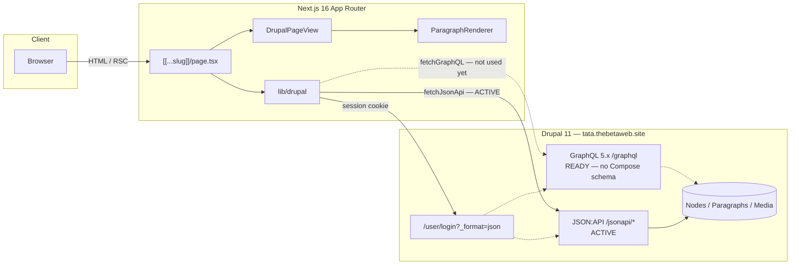
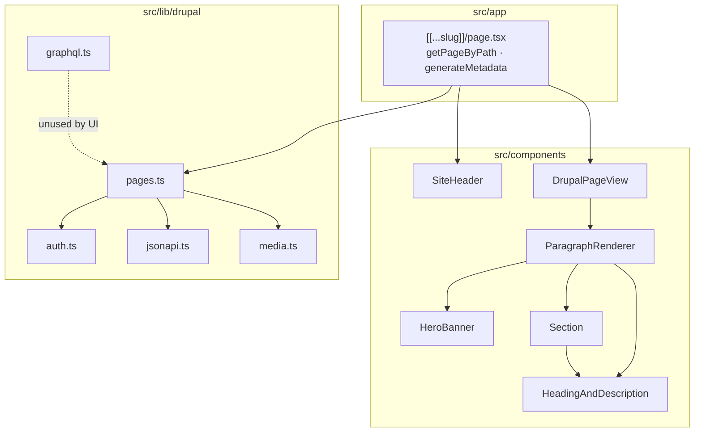
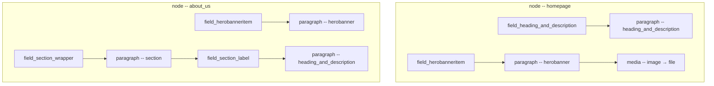
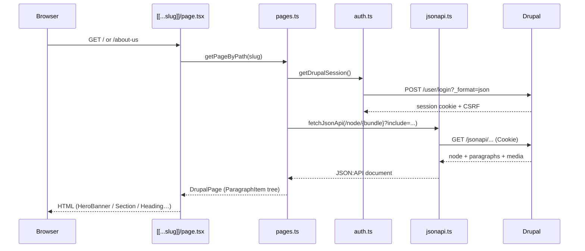

# Tata Steel — Headless Next.js

Next.js 16 frontend for a Drupal 11 headless CMS (JSON:API + GraphQL 5.x).

## Quick start

```bash
cp .env.example .env.local
# Set DRUPAL_USERNAME / DRUPAL_PASSWORD (quote passwords with special chars)
npm install
npm run dev
```

Open [http://localhost:3000](http://localhost:3000).

---

## Architecture overview

Interactive canvas (open beside chat): [headless-architecture.canvas.tsx](/Users/abhishek.kumar/.cursor/projects/Users-abhishek-kumar-Library-CloudStorage-OneDrive-OneWorkplace-MyProject-NextJs-tata-steel-tatasteel/canvases/headless-architecture.canvas.tsx)

### System architecture



### Next.js internal layers



### Content composition



### JSON:API vs GraphQL — where each is used

| Concern | API | Status | Code |
| --- | --- | --- | --- |
| Page/node loading | **JSON:API** | **Active** | `src/lib/drupal/pages.ts` → `fetchJsonApi()` |
| Paragraph includes (hero, section, heading) | **JSON:API** | **Active** | `include=` in `pages.ts` |
| Media / file URLs | **JSON:API** | **Active** | `src/lib/drupal/media.ts` |
| Auth for restricted entities | Session cookie (not GraphQL-specific) | **Active** | `src/lib/drupal/auth.ts` |
| Dynamic routes / metadata | Built on JSON:API page map | **Active** | `src/app/[[...slug]]/page.tsx` |
| Typed queries / Compose schema | **GraphQL** | **Client ready only** | `src/lib/drupal/graphql.ts` |

**JSON:API (in use today)**  
All live page rendering goes through JSON:API. The catch-all route calls `getPageByPath()` / `getAllPages()`, which request:

```http
GET /jsonapi/node/{bundle}?include=...&filter[status]=1
```

Bundle-specific includes:

| Bundle | Include path |
| --- | --- |
| `homepage` | `field_herobanneritem` (+ image media), `field_heading_and_description` |
| `about_us` | `field_herobanneritem` (+ image media), `field_section_wrapper.field_section_label` |
| `article` / `page` | hero include base only (no content yet) |

**GraphQL (prepared, not driving UI)**  
`fetchGraphQL()` in `src/lib/drupal/graphql.ts` can POST to `/graphql` with the same session auth headers. Drupal GraphQL 5.x is installed, but the exposed Query schema is currently empty (no GraphQL Compose / custom schema fields yet).

When GraphQL is configured, intended split:

| Use JSON:API when… | Use GraphQL when… |
| --- | --- |
| Simple CRUD-style resource reads | Nested page trees in one typed query |
| Standard Drupal entity REST shape is enough | Frontend needs precise field selection |
| Debugging via `/jsonapi/` browser links | Menus, route-by-path, or Compose fragments |

Until then, **do not call GraphQL from pages** — keep rendering on JSON:API.

### Request flow (current)



### Auth model

Drupal HTTP Basic Auth is **not** enabled on this site. The app logs in with:

```http
POST /user/login?_format=json
{ "name": "…", "pass": "…" }
```

Session cookie + CSRF token are cached in memory (`auth.ts`) and attached to JSON:API (and GraphQL) requests. Required because paragraph/media entities are not anonymously readable.

---

## Project structure

```
tatasteel/
├── .env.example
├── .env.local
├── next.config.ts              # Allows Drupal host for next/image
├── package.json
├── public/
└── src/
    ├── app/
    │   ├── layout.tsx
    │   ├── globals.css
    │   ├── not-found.tsx
    │   └── [[...slug]]/        # Dynamic CMS routes
    │       ├── page.tsx
    │       └── page.module.css
    ├── components/
    │   ├── SiteHeader.tsx
    │   ├── DrupalPageView.tsx
    │   └── paragraphs/
    │       ├── ParagraphRenderer.tsx       # Dispatches paragraph tree
    │       ├── HeroBanner.tsx              # herobanner + media
    │       ├── HeadingAndDescription.tsx   # heading + rich text
    │       └── Section.tsx                 # Parent wrapper (nested children)
    └── lib/drupal/
        ├── index.ts            # Public exports
        ├── config.ts           # Env + content type list
        ├── types.ts            # JSON:API + ParagraphItem types
        ├── auth.ts             # Session cookie login
        ├── jsonapi.ts          # ACTIVE data client
        ├── graphql.ts          # READY client (unused by UI)
        ├── media.ts            # field_image → file URL
        └── pages.ts            # Nodes, includes, path map, tree build
```

### App Router

| Path | Role |
| --- | --- |
| `layout.tsx` | Root HTML, fonts, metadata |
| `[[...slug]]/page.tsx` | Resolves all CMS pages; `generateStaticParams` + `generateMetadata` |
| `not-found.tsx` | No matching Drupal node |

### Components

| Component | Role |
| --- | --- |
| `SiteHeader` | Nav from Drupal page list |
| `DrupalPageView` | Title + paragraph tree + optional body |
| `ParagraphRenderer` | Recursively maps `ParagraphItem` → UI |
| `HeroBanner` | `field_header` + `field_image` |
| `HeadingAndDescription` | `field_header` + `field_description` |
| `Section` | Parent for nested paragraphs (`field_section_label`) |

### Drupal layer

| Module | API | Role |
| --- | --- | --- |
| `jsonapi.ts` | JSON:API | Fetch + auth headers + absolute URLs |
| `graphql.ts` | GraphQL | POST helper; not used by routes yet |
| `pages.ts` | JSON:API | Bundle fetches, includes, path aliases, paragraph tree |
| `media.ts` | JSON:API includes | Resolve hero image file URL |
| `auth.ts` | Drupal login | Session for both clients |

---

## Content model (Drupal)

### Content types

| Bundle | Used on | Fields |
| --- | --- | --- |
| `homepage` | `/`, `/homepage` | `field_herobanneritem`, `field_heading_and_description` |
| `about_us` | `/about-us` | `field_herobanneritem`, `field_section_wrapper` |
| `article`, `page` | — | Supported in code; empty in CMS |

### Paragraph types

| Paragraph | Parent field | Fields / children |
| --- | --- | --- |
| `herobanner` | `field_herobanneritem` | `field_header`, `field_image` → media → file |
| `heading_and_description` | `field_heading_and_description` (homepage) or nested under section | `field_header`, `field_description` |
| `section` | `field_section_wrapper` (about us) | `field_section_label` → nested `heading_and_description` |

### Nesting (About Us)

```
node--about_us
 ├─ field_herobanneritem[] → paragraph--herobanner
 └─ field_section_wrapper[] → paragraph--section
        └─ field_section_label[] → paragraph--heading_and_description
```

Frontend model: `ParagraphItem { resource, children[] }` built in `pages.ts`, rendered recursively by `ParagraphRenderer`.

---

## Routes

| URL | Source |
| --- | --- |
| `/` | Homepage (also `/homepage`) |
| `/about-us` | About Us (title slug if no Drupal path alias) |
| `/node/{nid}` | Canonical node fallback |

---

## Environment

| Variable | Purpose |
| --- | --- |
| `DRUPAL_BASE_URL` | Drupal origin |
| `DRUPAL_JSONAPI_PREFIX` | Default `/jsonapi` |
| `DRUPAL_GRAPHQL_PATH` | Default `/graphql` |
| `DRUPAL_USERNAME` / `DRUPAL_PASSWORD` | Session auth (required for paragraphs/media) |
| `DRUPAL_HOMEPAGE_ALIAS` | Default `/homepage` |

Endpoints:

- JSON:API: https://tata.thebetaweb.site/jsonapi/
- GraphQL: https://tata.thebetaweb.site/graphql

---

## Scripts

```bash
npm run dev                   # Development server
npm run build                 # Production build
npm run start                 # Serve production build
npm run lint                  # ESLint
npm run scaffold:paragraph    # Stub a new paragraph component + checklist
```

---

## Adding a new paragraph type

Every new Drupal paragraph needs wiring in **three places**. Skipping includes is
what usually breaks the site (JSON:API returns 400 and no pages load).

```bash
# Scaffolds component files + prints the checklist
npm run scaffold:paragraph -- Card
npm run scaffold:paragraph -- FeatureGrid --type feature_grid --nested field_items
```

### Checklist

| # | File | What to do |
| --- | --- | --- |
| 1 | `src/components/paragraphs/YourType/YourType.tsx` | Build the UI (scaffold creates a stub) |
| 2 | `src/lib/drupal/types.ts` | Add `*Attributes` + `*Resource` types |
| 3 | `src/lib/drupal/paragraph-registry.ts` | **Data layer** — nested fields + JSON:API includes |
| 4 | `src/components/paragraphs/paragraph-components.tsx` | **UI layer** — map `paragraph--your_type` → component |

### What goes in `paragraph-registry.ts`

1. **Nested under a parent?** Add the Drupal field machine name to `NESTED_PARAGRAPH_FIELDS`
   (e.g. Section gets `field_cards` → add `"field_cards"`).
2. **Needs to be fetched?** Add include path suffixes under the correct key in
   `INCLUDE_SUFFIXES_BY_NODE_FIELD`:
   - Homepage content → `field_section`
   - Allpage content → `field_components`
   - Nested two levels deep → `"field_section_label.field_button"` style paths
   - Media → use `withMediaChain("field_…", RESPONSIVE_MEDIA_INCLUDE)`
3. **New top-level node field?** Add it to `NODE_PARAGRAPH_FIELDS_BY_BUNDLE` **and**
   add a matching entry in `INCLUDE_SUFFIXES_BY_NODE_FIELD`.

Only include fields that exist on at least one allowed target type of that
relationship. Invalid includes fail the entire bundle fetch.

### Nested components (example)

Drupal:

```
node--allpage
 └─ field_components[] → paragraph--section
        ├─ field_section_label[] → paragraph--heading_and_description
        │      └─ field_button[] → paragraph--button
        └─ field_background_media → paragraph--responsive_image
```

Homepage `field_section` can also hold `herobanner` (with `field_background_media` + `field_button`) directly.

Frontend updates:

1. `NESTED_PARAGRAPH_FIELDS` already has `field_section_label`, `field_button`, `field_background_media`
2. `INCLUDE_SUFFIXES_BY_NODE_FIELD.field_components` must list:
   - `field_section_label`
   - `field_section_label.field_button`
   - `field_background_media` + media chain
3. Each paragraph type registered in `paragraph-components.tsx`
4. Parents that render children call `renderChildren(item.children)` (see Section / HeadingAndDescription)

### Why it breaks

| Symptom | Likely cause |
| --- | --- |
| All pages error / JSON:API 400 | Bad or unknown path in `INCLUDE_SUFFIXES_BY_NODE_FIELD` |
| Empty section / missing children | Field missing from `NESTED_PARAGRAPH_FIELDS` or include too shallow |
| "Unsupported paragraph type" | Missing entry in `paragraph-components.tsx` |
| allpage has no content | Node field missing from `NODE_PARAGRAPH_FIELDS_BY_BUNDLE` |

## Switching a feature to GraphQL later

1. Configure GraphQL Compose (or custom schema) on Drupal so `/graphql` exposes queries
2. Add a query module (e.g. `src/lib/drupal/queries/page.ts`) using `fetchGraphQL()`
3. Swap `getPageByPath` / `getAllPages` implementations (keep the same return types)
4. Leave JSON:API available for media debugging and fallbacks
